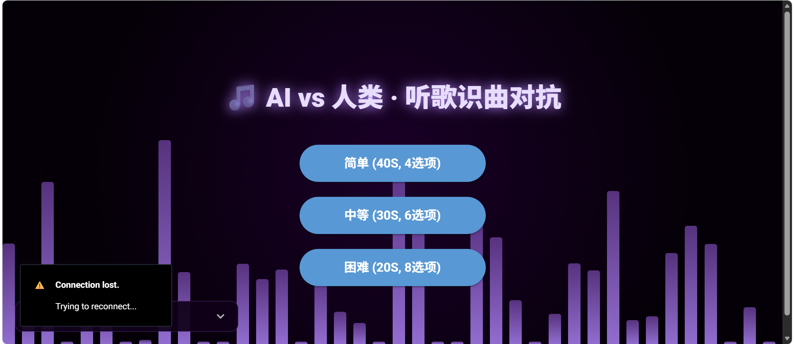
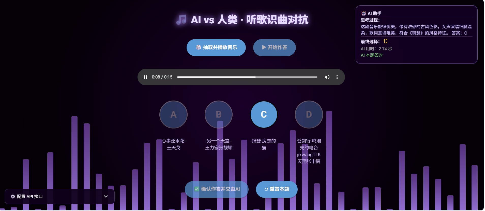
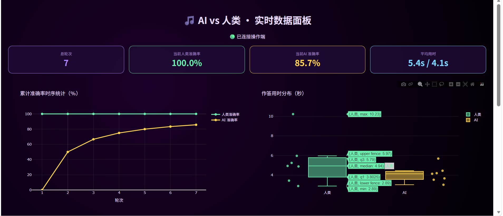

### Guess_Music
Guess music challenge game between humans and AI! Customized local music dataset and difficulty setting! Choose Qwen-Audio-3.1-Realtime-Flash as representative of LLMs. Use websocket-client package in manual management mode to call Qwen api.

### 项目简介
"弦外之音"是一个人与AI猜音乐博弈的舞台互动游戏，支持定制本地音乐数据库和三种难度！选择Qwen-Audio-3.1-Realtime-Flash作为大模型的代表，使用websocket-client的手动请求-接收模式调用千问api接口。

### 环境配置
cd 项目根目录
conda create -n Guess_Music python=3.12.15 -y
conda activate Guess_Music
pip install -r requirements.txt

### 项目运行
python Guess_Music.py
python Screen_Show.py

### 注意事项
(1)运行之后打开http://127.0.0.1:8000进入网页交互作答端，打开http://127.0.0.1:8050进入统计看板展示端
(2)交互作答前在左下角的API配置弹窗粘贴自己的阿里云百炼API钥匙，并点击保存
(3)不同模式可以自由切换作答，统计看板综合记录各难度作答成绩
(4)点击开始作答前可以重复抽题换题，开始作答之后也可以重置本题（如果没准备好作答或者抽取的片段不含任何歌词）
(5)MUSIC_DIR填写本地音乐数据库目录，BASR_DIR不需要可以直接删除,STATIC_DIR默认在项目根目录下创建/static_audio子目录存放抽中歌曲的15秒随机剪切片段
(6)各难度的最大作答时长和选项个数支持个性化定义
(7)目前v1.0对多页面异步并发访问的支持有限，暂不支持跨设备访问。

